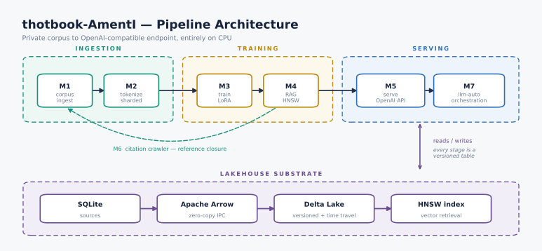

> **EDUCATIONAL PURPOSE ONLY** — This software is provided strictly for
> research, learning, and academic exploration. It is not intended for
> production use, commercial deployment, or any application where failure
> could cause harm. Use at your own risk.

<div align="center">


# thotbook-ai

[](https://thotbook-ai.readthedocs.io/en/latest/)
[](LICENSE)
[](https://www.rust-lang.org/)
[](#)
[](#)

</div>


> **A private, local-first LLM training-to-serving pipeline in Rust.**
> Ingest your own knowledge corpus → tokenize → fine-tune → retrieve → serve
> an OpenAI-compatible private model. CPU-friendly, redaction-first,
> lakehouse-native.

---

## Overview

thotbook-ai turns your private documents, research notes, session transcripts
and paper indexes into a *personal language model* — fully on your own
hardware. It is built as six focused Rust crates wired together by a Polarway
Delta lakehouse:

<div align="center">

<picture>
  <source media="(prefers-color-scheme: dark)"
          srcset="docs/diagrams/thotbook_pipeline_dark.svg">
  <source media="(prefers-color-scheme: light)"
          srcset="docs/diagrams/thotbook_pipeline.svg">
  
</picture>

</div>

Every stage reads from / writes to an **Apache Arrow → Delta Lake** lakehouse
(`data/lakehouse`), so any step can be re-run idempotently without losing data.

| Milestone | Crate | Purpose | Status |
| --- | --- | --- | --- |
| M1 | `llm-corpus` | Redact + ingest SQLite sources (sessions, papers, notebooks, equations, arxiv) into Delta tables | ✅ implemented |
| M2 | `llm-tokenize` | Tokenize lakehouse tables into sharded Arrow IPC training files | ✅ implemented |
| M3 | `llm-train` | CPU LoRA fine-tuning with real forward/loss computation | ✅ implemented |
| M4 | `llm-rag` | Embeddings + HNSW retrieval over the corpus | ✅ implemented |
| M5 | `llm-serve` | Private OpenAI-compatible Qwen3-8B server (candle, CPU) + `/v1/embeddings` | ✅ implemented |
| M6 | `llm-corpus` (crawler) | arXiv reference-closure citation crawler → `datasets.citations` | 🚧 planned |
| **M7** | `llm-auto` | **Autonomous orchestration**: task decomposition, sub-agents, self-training, paper generation | ✅ implemented |

## Design principles

- **Private by design.** Content is redacted at ingest time
  (`redact.rs` / `redact.py`, parity with the JS reference implementation).
  A write-time leak audit refuses to append any row that still contains
  secrets after redaction.
- **CPU-only.** No GPU required — the whole pipeline targets a 32 GB RAM
  laptop. Quantization and LoRA keep training and inference feasible on CPU.
- **Lakehouse-native.** Every stage produces versioned, queryable Delta
  tables (time-travel included) instead of ad-hoc files.
- **OpenAI-compatible surface.** Drop-in replacement for
  `POST /v1/chat/completions` on your own model.
- **Parity everywhere.** The redaction rules and tokenizer defaults are kept
  in lock-step between Rust, Python and the JS reference implementation.
- **Autonomous research.** Self-improving LLM that can decompose tasks, train
  on its own outputs, and generate research papers without external model dependencies.

## Repository layout

```text
thotbook-ai/
├── Cargo.toml                  # workspace root (6 members)
├── crates/
│   ├── llm-corpus/             # M1: SQLite → redacted Arrow → Delta
│   ├── llm-tokenize/           # M2: tokenizer + sharded Arrow IPC
│   ├── llm-train/              # M3: QLoRA SFT (placeholder → in dev)
│   ├── llm-rag/                # M4: embeddings + HNSW (placeholder → in dev)
│   ├── llm-serve/              # M5: axum OpenAI-compatible server
│   └── llm-cli/                # unified CLI entrypoint (placeholder)
├── python/thotbook_ai/          # thin Python connectors (polars/pyarrow)
├── data/                       # lakehouse + tokenized shards (gitignored)
└── docs/                       # Sphinx docs (ReadTheDocs)
```

## Requirements

- **Rust** 1.92+ (stable)
- **Python** 3.10+ (only for the optional Python connectors)
- 16 GB+ RAM recommended (32 GB for M3 training / M5 Qwen3-8B serving)
- macOS or Linux

> **Note on `polarway-lakehouse`.** The workspace resolves
> `polarway-lakehouse` from a sibling checkout via a path dependency
> (`../polarway/polarway-lakehouse`). It is a private companion crate
> (Delta lakehouse primitives: `DeltaStore`, `ensure_table`, `append`,
> `scan`, `sql`, `compaction`). Check it out next to this repository and
> `cargo build` will resolve it. Everything else is crates.io.

## Quick start

```sh
# 1. Build the pipeline binaries
cargo build --release

# 2. Ingest SQLite sources into the lakehouse (redacts, refuses leaked rows)
cargo run --release -p llm-corpus -- ingest \
  --historia  /path/to/historia.db \
  --thotbook  /path/to/thotbook.db \
  --lakehouse data/lakehouse
# → writes datasets.sessions, datasets.corpus, datasets.equations, datasets.citations

# 3. Tokenize a lakehouse table into training shards
#    (downloads the Qwen3 tokenizer on first use)
cargo run --release -p llm-tokenize -- tokenize \
  --lakehouse data/lakehouse \
  --table datasets.sessions

# 4. Serve the private model (OpenAI-compatible, http://127.0.0.1:8100)
cargo run --release -p llm-serve -- --model-dir data/models/qwen3-8b
```

The tokenizer is fetched automatically on first use:
`https://huggingface.co/Qwen/Qwen3-4B/resolve/main/tokenizer.json`
→ `data/tokenizers/qwen3-tokenizer.json`.

### Example ingest output

```text
2026-08-09 INFO  llm_corpus: starting ingest
2026-08-09 INFO  rows=342 version=1 "wrote sessions"
2026-08-09 INFO  rows=256 version=1 "wrote corpus"
2026-08-09 INFO  rows=1943 version=1 "wrote equations"
2026-08-09 INFO  rows=60 version=1 "wrote citations"
2026-08-09 INFO  llm_corpus: ingest complete
```

Leaked rows (secrets still present after redaction) are reported and the
write is refused — the lakehouse never sees them.

## OpenAI-compatible server (M5)

`llm-serve` runs a **Qwen3-8B** model via `candle` with a seeded
greedy / temperature / top-p sampler, wrapped in an axum HTTP server.

| Endpoint | Description |
| --- | --- |
| `GET /health` | liveness probe |
| `GET /v1/models` | model id (e.g. `Qwen/Qwen3-8B`) |
| `POST /v1/chat/completions` | OpenAI-compatible chat completion |

```sh
curl http://127.0.0.1:8100/v1/chat/completions \
  -H 'Content-Type: application/json' \
  -d '{"model":"Qwen/Qwen3-8B","messages":[{"role":"user","content":"Explain a Hawkes process."}],"temperature":0.7}'
```

Configuration is env-driven with sane defaults; every setting can be
overridden by CLI flags:

| Env var | Default | Description |
| --- | --- | --- |
| `LLM_SERVE_MODEL_ID` | `Qwen/Qwen3-8B` | HF model id (shown in `/v1/models`) |
| `LLM_SERVE_MODEL_DIR` | `data/models/qwen3-8b` | dir with `config.json` + `*.safetensors` |
| `LLM_SERVE_TOKENIZER_PATH` | `data/tokenizers/qwen3-tokenizer.json` | tokenizer file |
| `LLM_SERVE_HOST` | `127.0.0.1` | bind interface |
| `LLM_SERVE_PORT` | `8100` | bind port |
| `LLM_SERVE_MAX_TOKENS` | `512` | default generation length |
| `LLM_SERVE_TEMPERATURE` | `0.7` | sampling temperature (0 = greedy) |
| `LLM_SERVE_TOP_P` | `0.9` | nucleus sampling |

Download the weights with:

```sh
huggingface-cli download Qwen/Qwen3-8B-Instruct --local-dir data/models/qwen3-8b
```

## Python connectors

Thin, build-free Python connectors that shell out to the compiled Rust
binaries and read results with **polars** — plus a `ChatClient` for the
local server:

```python
from thotbook_ai import ChatClient, CorpusClient, load_tokenizer, tokenize_doc, redact_secrets

# Local open-source chat — no API key, no billing, free by design.
with ChatClient() as assistant:            # http://127.0.0.1:8100/v1, Qwen/Qwen3-8B
    if assistant.is_online():
        reply = assistant.ask("Give one line of Kähler geometry intuition.")
        print(reply.text)

client = CorpusClient()              # defaults to data/lakehouse
client.tables()                      # ['datasets.citations', 'datasets.corpus', ...]
df = client.read("datasets.sessions")  # polars.DataFrame

redact_secrets("token=abc123")       # 'token=[REDACTED]'
contains_secrets("token=[REDACTED]") # False
```

```sh
pip install -e python/thotbook_ai
python -m thotbook_ai tables
python -m thotbook_ai health     # server status
python -m thotbook_ai chat "What is a fibration?"   # local inference
```

## A free Copilot, built by us

thotbook-ai is the model side of the HFThot Research Lab toolset: the
same corpus pipeline that ingests our sessions, notebooks and paper indexes
can fine-tune (`llm-train`) and serve a **local, open-source, CPU-only**
assistant — no subscription, no data leaving the machine. It is open-source
(Apache 2.0 weights, MIT/Apache code), free by principle (public research,
no vendor lock-in) and free by design (local-first, private).

## Testing

```sh
cargo test --workspace   # 89 tests: llm-serve (22), llm-ingest (15), llm-train (15),
                         #   llm-rag (13), llm-tokenize (10), llm-corpus (9),
                         #   llm-auto (4), llm-salviers (1)
                         # llm-train/llm-rag include characterization suites that
                         # pin two known defects - see notebooks/08 and loss.rs
pytest python/thotbook_ai/tests   # ChatClient mock + live integration (live auto-skips when server offline)
```

The redaction suite keeps Rust, Python and the JS reference in parity, and
`llm-serve` includes live HTTP tests against the running axum router.

## Getting a model

The Makefile reads live sizes from the HuggingFace API, measures your actual
bandwidth, and tells you whether a model fits this machine *before* you commit
to the download:

```sh
make models                             # size, ETA, and "does it fit 32 GB"
make plan-model  MODEL=dllama-qwen3-8b  # the plan only
make setup-model MODEL=dllama-qwen3-8b  # same plan, then y/N, then download
make doctor                             # installed / running / reachable
```

Two backends, and the difference matters:

| Backend | Path | Format | Notes |
| --- | --- | --- | --- |
| `candle` | `crates/llm-serve` | F16 safetensors | Qwen3 architecture only; peak RSS is ~2x the weights, so 4B is the practical ceiling on 32 GB |
| `dllama` | `../distributed-llama-cloudnostic` | 4-bit q40 | the only way to run a real 8B here; tensor-parallel over 2^n nodes; **inference only, no backward pass** |

```sh
make serve MODEL=qwen3-1.7b                    # candle, :8100
make dllama-serve MODEL=dllama-qwen3-8b        # 4-bit, :9990
make opencode-register MODEL=dllama-qwen3-8b   # add to opencode.json
```

## Training on your own history

```sh
make historia-db        # index the session files into a clean SQLite
make train-historia     # ingest -> tokenize -> CPU LoRA, end to end
```

`make historia-db` exists because the `historia-mcp` copy of `historia.db` is
truncated at exactly 1,000,000,000 bytes and fails `pragma integrity_check`;
the session files themselves are intact, so the index is rebuilt from those.

## The runnable guide

`notebooks/08_thotbook_ai_guide.ipynb` is the single executable reference:
which tests pass, the equations behind training and retrieval each paired with
the line that implements it, five benchmarks measured on your own host, and the
ordered steps to train and then use the model. Every number in it is produced
by the cell above it.

```sh
cd notebooks && ../.venv/bin/python build_nb08_guide.py   # rebuilds + re-executes
```

## Reproducing the paper

```sh
make verify-paper       # every falsifiable claim, with evidence
```

Each claim comes back `PASS` (measured here), `FAIL` (measured, contradicts
the paper), `BLOCKED` (needs weights, a labelled set, or the second node) or
`ABSENT` (the paper describes machinery this tree does not contain). The
command exits non-zero if anything is `FAIL` or `ABSENT`, so CI can gate on
it. Run it before citing a number from `papers/thotbook_ai_arxiv.pdf`.

## Documentation

Full documentation is hosted on **ReadTheDocs**:
**https://thotbook-ai.readthedocs.io/** — see the `docs/` folder for the
Sphinx sources. Sibling projects: [optimiz-rs](https://optimiz-r.readthedocs.io/)
(numerical primitives) and [Polarway](https://polarway.readthedocs.io/)
(lakehouse / streaming).

## Roadmap

- **M3 `llm-train`** — CPU QLoRA SFT of Qwen3-4B on the tokenized corpus,
  reusing the LoRA / Q4-quantization math in `optimiz-rs`.
- **M4 `llm-rag`** — corpus embeddings + HNSW retrieval (the HNSW index is
  already exercised as a reusable primitive).
- **M6 citation crawler** — arXiv reference-closure to enrich
  `datasets.citations` edges.
- **`llm-cli`** — a single entrypoint orchestrating the whole pipeline.

## License

MIT OR Apache-2.0 (see `LICENSE`).
